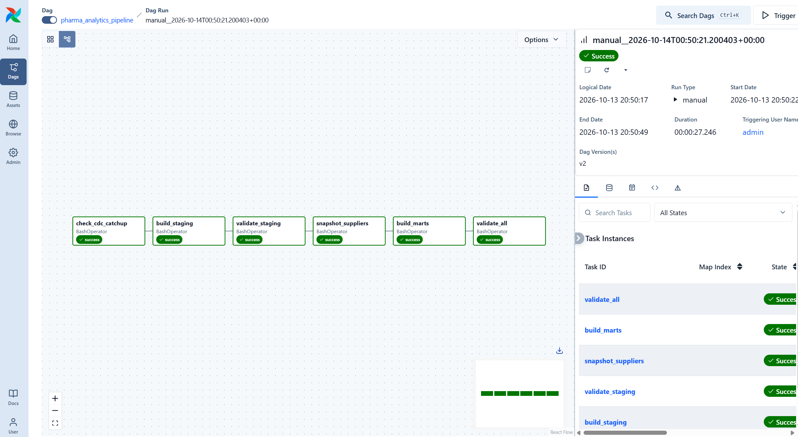
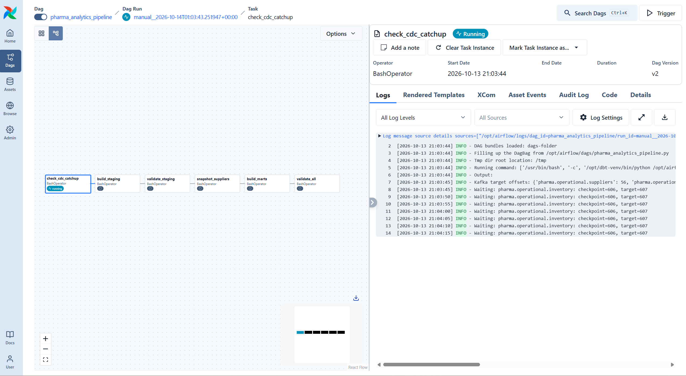
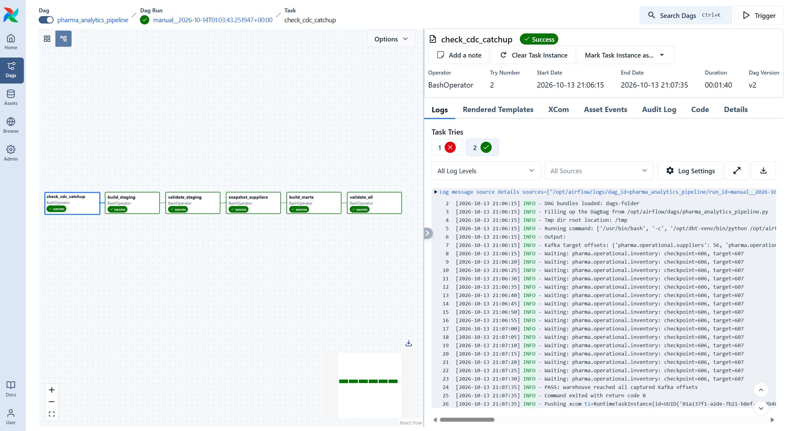
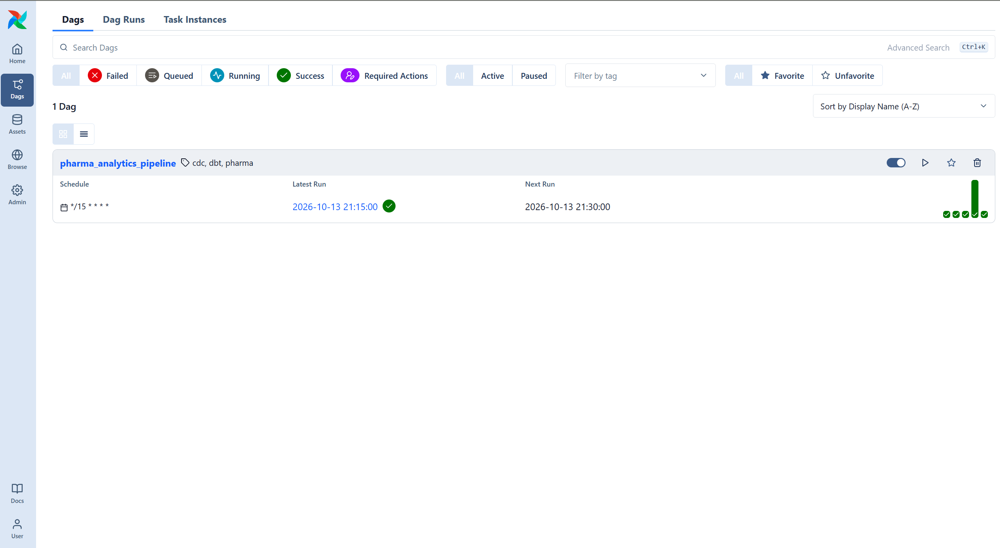
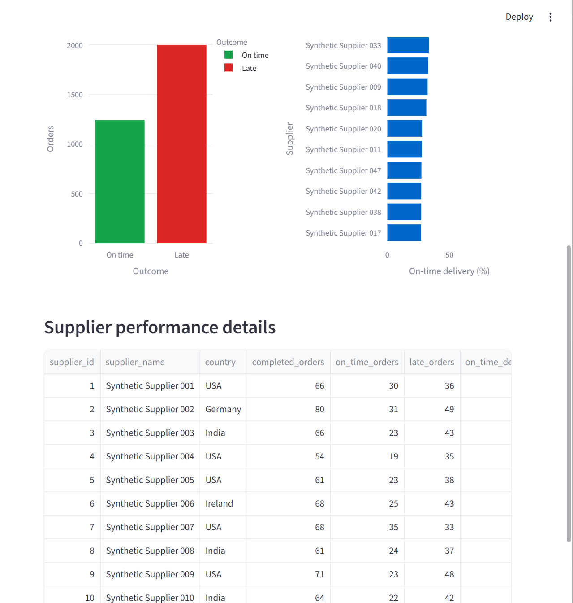
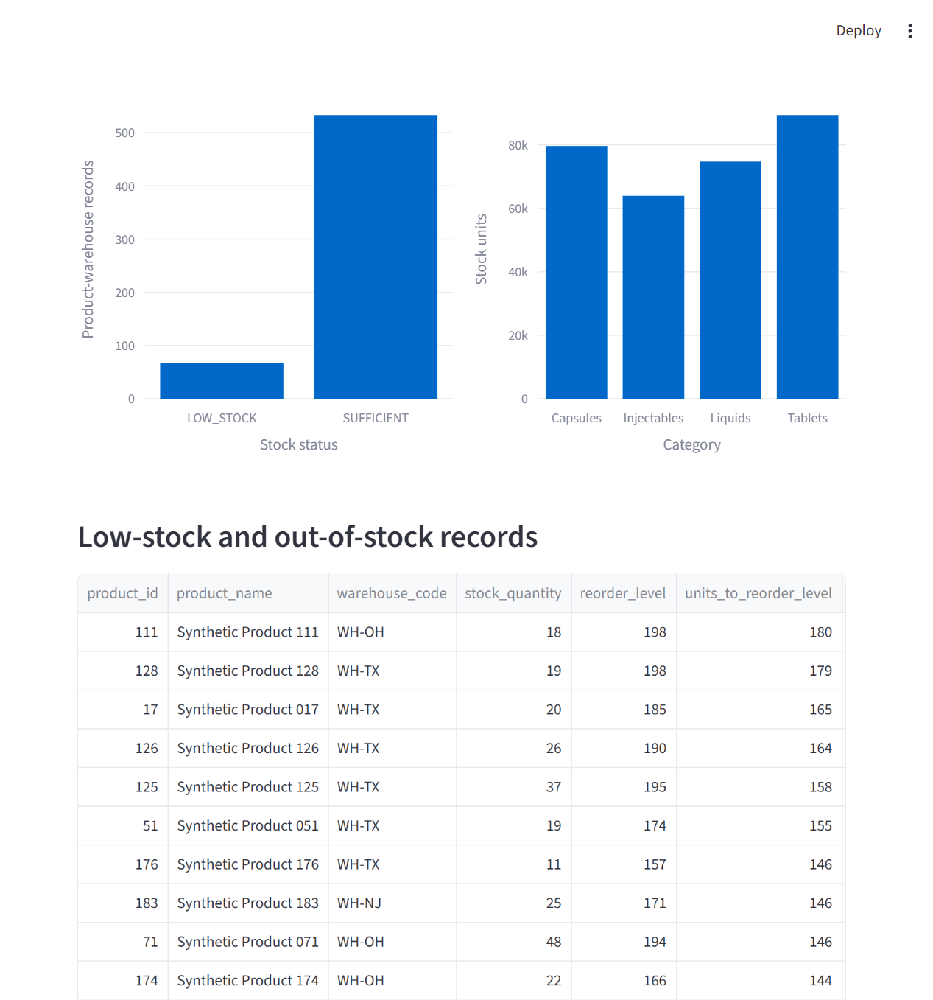
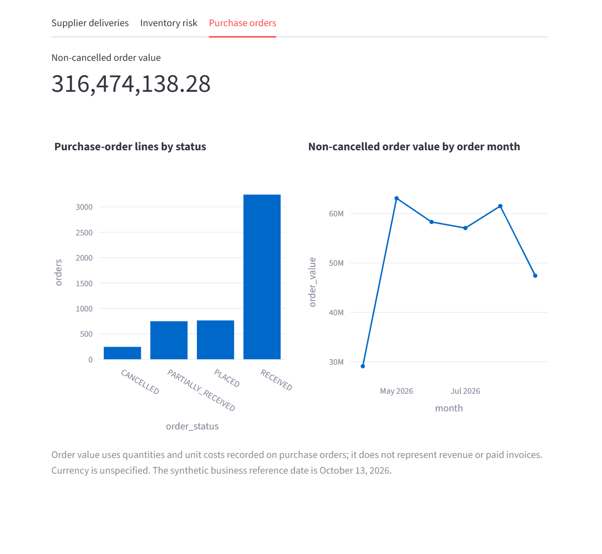

# Pharmaceutical Supply Chain CDC & Analytics Platform

A data engineering portfolio project that captures PostgreSQL changes with Debezium and Kafka, loads them into an analytical warehouse using Python, and builds validated supply-chain reports with dbt and Apache Airflow.

All business data is synthetic. The project runs locally using Docker.

## Business Problem

Supplier details, purchase orders, shipments, and inventory change over time. Reports need to reflect inserts, updates, and deletes without duplicating records or losing important history.

This project demonstrates database change capture, incremental processing, replay safety, restart recovery, supplier history, and analytics for delivery performance and inventory risk.

## Architecture

| Component | Purpose |
|---|---|
| PostgreSQL source | Operational business tables |
| Debezium | Initial snapshot and database change capture |
| Kafka | Durable change-event topics |
| Python consumer | Event storage, current-state updates, and transactional checkpoints |
| PostgreSQL warehouse | Raw events, current records, history, and analytics |
| dbt | Transformations, incremental modeling, snapshots, and tests |
| Apache Airflow | Scheduled orchestration, catch-up gate, retries, and validation |
| Streamlit | Business dashboard |
| GitHub Actions | Python syntax, Compose configuration, and dbt parsing checks |

## Source Dataset

| Table | Initial records |
|---|---:|
| Suppliers | 50 |
| Products | 200 |
| Purchase orders | 5,000 |
| Shipments | 4,740 |
| Inventory | 600 |
| **Total** | **10,590** |

Each purchase-order row represents one product line. An order can have multiple shipments.

Inventory represents an independent opening balance across three warehouses. It is not calculated from the purchase-order dataset.

## Key Engineering Features

### Change Data Capture

- Captured an initial snapshot of all five source tables.
- Verified live supplier updates.
- Exercised temporary supplier inserts and deletes.
- Handled delete events and Kafka tombstones.
- Stored raw messages uniquely by topic, partition, and offset.

### Replay Safety and Recovery

- Replayed 10,594 messages without increasing stored message or active-record counts.
- Retained delete markers to prevent older events from restoring deleted records.
- Verified recovery after a source update while the consumer was stopped.
- Applied event storage, current-state changes, and checkpoints in one PostgreSQL transaction.
- Used an advisory lock to prevent concurrent warehouse loader instances.

This demonstrates replay-safe warehouse application, rather than a claim of end-to-end exactly-once delivery.

### Supplier History

A dbt SCD Type 2 snapshot preserves observed supplier attribute changes.

The history test changed supplier 1's lead time from five days to six days:

- The previous version was closed.
- The new version remained current.
- The snapshot contained 51 historical versions across 50 current suppliers.

Snapshots record states observed when they run. Individual changes remain available in raw CDC storage.

### Incremental Inventory

The incremental inventory model compares each record's CDC offset with its stored offset.

Verified behaviors:

- Initial load of 600 active inventory records.
- A 10-unit stock update without creating additional rows.
- Insertion and deletion of a temporary inventory record.
- Retention of the delete marker in the incremental table.
- Exclusion of deleted inventory from reporting.

Only the inventory current-state dbt model uses incremental materialization. Staging models are views; purchase-order facts and business reports rebuild as tables.

## Analytics Models

| Model | Purpose |
|---|---|
| `stg_suppliers` | Typed active supplier records |
| `stg_products` | Typed active product records |
| `stg_purchase_orders` | Typed active purchase-order records |
| `stg_shipments` | Typed active shipment records |
| `stg_inventory` | Typed active inventory records |
| `snap_suppliers` | Historical supplier versions |
| `fct_purchase_orders` | One row per purchase-order product line |
| `int_inventory_current` | Incremental inventory state and delete markers |
| `mart_supplier_performance` | Delivery performance and actual lead times |
| `mart_inventory_risk` | Stock status by product and warehouse |

Shipments are aggregated before joining purchase orders, preventing duplicated order quantities and values.

## Verified Results

| Metric | Observed value |
|---|---:|
| Initial source records | 10,590 |
| Purchase-order lines | 5,000 |
| Ordered units across all statuses | 1,288,845 |
| Order value across all statuses | 332,490,837.28 |
| Completed orders | 3,242 |
| On-time completed orders | 1,242 |
| Late completed orders | 2,000 |
| Overall on-time delivery rate | 38.31% |
| Active inventory records | 600 |
| Inventory stock units after update test | 307,706 |
| Passing dbt data tests | 39 |

Order values use purchase-order quantities and recorded unit costs. Currency is unspecified. These values do not represent revenue or paid invoices.

On-time delivery is evaluated for fully received orders against expected delivery dates.

Product reorder thresholds are applied separately to each warehouse. Inventory shortfalls are not demand forecasts or purchasing recommendations.

## Data Quality

The 39-test dbt suite covers:

- Unique and non-null identifiers.
- Supplier, product, and purchase-order relationships.
- Accepted order and shipment statuses.
- Quantity, cost, and date rules.
- Product-and-warehouse inventory uniqueness.
- Purchase-order count, quantity, and value reconciliation.
- Inventory row-level reconciliation.
- Supplier metric consistency.
- Incremental inventory values, CDC offsets, and delete markers.

## Airflow Orchestration

The DAG executes six tasks:

1. `check_cdc_catchup`
2. `build_staging`
3. `validate_staging`
4. `snapshot_suppliers`
5. `build_marts`
6. `validate_all`

Schedule: every 15 minutes while the computer, Docker services, and consumer are running.

### Catch-Up and Retry Test

A controlled test stopped the consumer and created a pending inventory event:

- Warehouse checkpoint: 606.
- Kafka target offset: 607.
- The gate waited while downstream tasks remained unstarted.
- The first attempt timed out.
- The retry succeeded after the consumer restarted.
- All six tasks completed successfully.

The gate compares warehouse checkpoints with Kafka end offsets captured at task start. It does not measure Debezium source replication lag or freeze warehouse data during transformation.

An earlier five-task manual workflow completed in approximately 28 seconds. This is an observed local execution, not a performance benchmark.

## Dashboard

The Streamlit dashboard includes:

- Purchase-order and completed-order KPIs.
- Overall on-time delivery percentage.
- Supplier delivery outcomes and performance details.
- Inventory stock-status charts.
- Warehouse filtering and low-stock records.
- Purchase-order statuses and monthly non-cancelled order values.

The dashboard reads materialized warehouse reports. Its refresh button reloads data; Airflow refreshes the underlying analytical tables.

## Repository Structure

```text
pharma-supply-chain-cdc/
├── .github/workflows/ci.yml
├── airflow/dags/
│   ├── pharma_analytics_pipeline.py
│   └── check_cdc_catchup.py
├── dashboard/app.py
├── dbt/
│   ├── models/staging/
│   ├── models/marts/
│   ├── snapshots/
│   ├── tests/
│   ├── dbt_project.yml
│   └── profiles.yml
├── docker/Dockerfile.airflow
├── ingestion/consume_cdc.py
├── scripts/
│   ├── generate_source_data.py
│   └── register_connector.ps1
├── screenshots/
├── sql/
│   ├── 01_source_schema.sql
│   ├── 02_seed_source.sql
│   └── 03_warehouse_schema.sql
├── compose.yaml
├── compose.cdc.yaml
├── compose.airflow.yaml
├── .env.example
├── .gitignore
├── requirements.txt
├── requirements-lock.txt
└── README.md
```

## Local Setup

Prerequisites:

- Docker Desktop with Linux containers.
- Python 3.11.
- Git.
- PowerShell.

Run the following commands from the project root.

### 1. Configure Python and Credentials

```powershell
python -m venv .venv
.\.venv\Scripts\python.exe -m pip install -r requirements-lock.txt
```

If `.env` does not already exist:

```powershell
Copy-Item .env.example .env
```

Edit `.env` with two different local database passwords:

```dotenv
SOURCE_DB_PASSWORD=your_local_source_password
WAREHOUSE_DB_PASSWORD=your_local_warehouse_password
```

Use letters and numbers for this demonstration's password-loading scripts. Never commit `.env`.

### 2. Start the Databases

```powershell
docker compose up -d --wait
docker compose ps
```

Both databases should be healthy.

### 3. Create and Seed the Source Tables

```powershell
docker compose cp ./sql/01_source_schema.sql source-db:/tmp/01_source_schema.sql

docker compose exec -T source-db psql -U pharma -d pharma_source -v ON_ERROR_STOP=1 -f /tmp/01_source_schema.sql

.\.venv\Scripts\python.exe scripts/generate_source_data.py

docker compose cp ./sql/02_seed_source.sql source-db:/tmp/02_seed_source.sql

docker compose exec -T source-db psql -U pharma -d pharma_source -v ON_ERROR_STOP=1 -f /tmp/02_seed_source.sql
```

The seed script requires empty source tables and refuses accidental reloads.

### 4. Create the Warehouse Tables

```powershell
docker compose cp ./sql/03_warehouse_schema.sql warehouse-db:/tmp/03_warehouse_schema.sql

docker compose exec -T warehouse-db psql -U warehouse -d pharma_warehouse -v ON_ERROR_STOP=1 -f /tmp/03_warehouse_schema.sql
```

### 5. Start Kafka and Connect

```powershell
docker compose -f compose.yaml -f compose.cdc.yaml up -d
```

Wait until Kafka is healthy and Connect responds:

```powershell
Invoke-RestMethod -Uri "http://127.0.0.1:8083/"
```

Register the PostgreSQL CDC connector:

```powershell
.\scripts\register_connector.ps1
```

If PowerShell blocks this local script, review its contents and run it in a separate process:

```powershell
powershell.exe -NoProfile -ExecutionPolicy Bypass -File .\scripts\register_connector.ps1
```

The registration script reads the source password from `.env` and suppresses the configuration response containing credentials.

Check connector status:

```powershell
Invoke-RestMethod -Uri "http://127.0.0.1:8083/connectors/pharma-source-connector/status" | ConvertTo-Json -Depth 10
```

The connector and task should show `RUNNING`.

### 6. Start the Warehouse Consumer

```powershell
.\.venv\Scripts\python.exe ingestion/consume_cdc.py
```

Keep this terminal running. Confirm the initial active warehouse counts match the source before building analytics.

For intentional replay testing:

```powershell
.\.venv\Scripts\python.exe ingestion/consume_cdc.py --replay
```

Stop the existing consumer before starting a replay.

### 7. Configure and Run dbt

Open a second PowerShell terminal at the project root.

Load the warehouse password into this terminal's environment:

```powershell
$passwordLine = Get-Content ".env" |
    Where-Object { $_ -match '^WAREHOUSE_DB_PASSWORD=' } |
    Select-Object -First 1

if (-not $passwordLine) {
    throw "WAREHOUSE_DB_PASSWORD is missing from .env"
}

$env:DBT_ENV_SECRET_WAREHOUSE_PASSWORD = ($passwordLine -split '=', 2)[1].Trim()
```

Then run:

```powershell
.\.venv\Scripts\dbt.exe debug --project-dir dbt --profiles-dir dbt

.\.venv\Scripts\dbt.exe run --project-dir dbt --profiles-dir dbt --select path:models/staging

.\.venv\Scripts\dbt.exe snapshot --project-dir dbt --profiles-dir dbt

.\.venv\Scripts\dbt.exe run --project-dir dbt --profiles-dir dbt --select path:models/marts

.\.venv\Scripts\dbt.exe test --project-dir dbt --profiles-dir dbt
```

Repeat the password-loading step when opening a new terminal for dbt.

### 8. Start Airflow

```powershell
docker build -f docker/Dockerfile.airflow -t pharma-airflow:local .

docker compose -f compose.yaml -f compose.cdc.yaml -f compose.airflow.yaml up -d airflow
```

Open:

```text
http://127.0.0.1:8080
```

Read the generated login credentials locally:

```powershell
docker compose -f compose.yaml -f compose.cdc.yaml -f compose.airflow.yaml exec -T airflow cat /opt/airflow/simple_auth_manager_passwords.json.generated
```

Keep the generated password private.

Enable `pharma_analytics_pipeline`. Keep the CDC consumer running for scheduled execution.

### 9. Start the Dashboard

In another terminal:

```powershell
.\.venv\Scripts\python.exe -m streamlit run dashboard/app.py --server.address 127.0.0.1 --server.port 8501
```

If Streamlit prompts for an onboarding email, leave it blank and press Enter.

Open:

```text
http://127.0.0.1:8501
```

## CI Validation

The GitHub Actions workflow checks:

- Python syntax.
- Combined Docker Compose configuration.
- dbt model, snapshot, and test parsing.

These checks passed locally. GitHub-hosted execution must be verified after repository publication.

CI does not run the 39 database tests or deploy infrastructure.

## Screenshots

### Successful CDC Analytics Workflow



### Catch-Up Gate Waiting



### Retry and Recovery



### Scheduled Execution



### Supplier Dashboard



### Inventory Dashboard



### Purchase-Order Dashboard



## Shutdown

Stop the Python consumer and Streamlit terminals with Ctrl+C.

Stop the Docker services while retaining data volumes:

```powershell
docker compose -f compose.yaml -f compose.cdc.yaml -f compose.airflow.yaml down
```

Do not add `--volumes` unless intentionally deleting the stored databases, Kafka data, and Airflow state.

## Scope and Limitations

- Local portfolio demonstration using synthetic data.
- Single Kafka broker and one partition per source topic.
- Airflow standalone mode and local development database accounts.
- CDC ingestion runs separately from Airflow.
- Supplier snapshots preserve observed states rather than every intermediate change.
- Warehouse changes may continue during analytics processing.
- No cloud deployment has been completed.
- Full-refresh versus incremental performance comparison has not yet been measured.
- Test-exercise metrics differ from a fresh installation because temporary records and updates were introduced.

## Future Improvements

- Dedicated least-privilege database accounts.
- Source replication-lag monitoring.
- Database integration tests in GitHub Actions.
- Additional historical dimensions.
- Controlled incremental versus full-refresh performance measurements.
- Cloud deployment with persistent storage, private networking, and managed secrets.